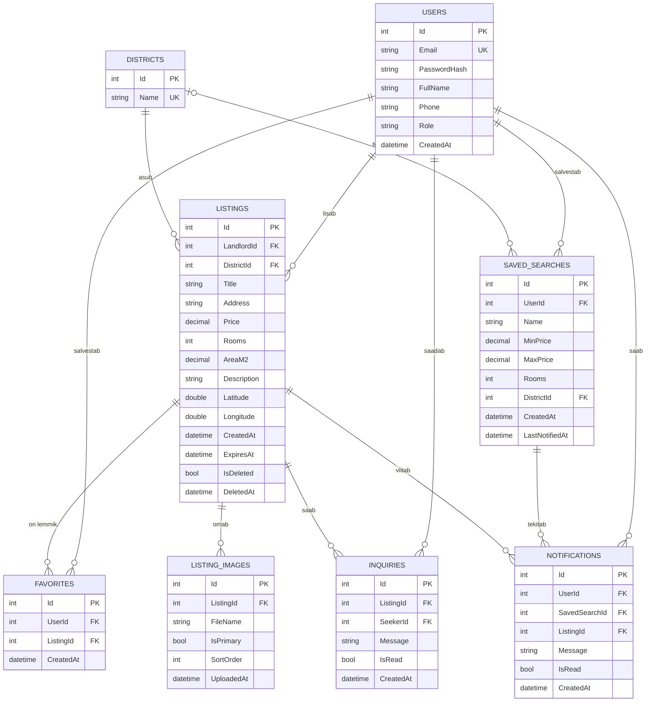

# Kodu24 andmemudel

Andmebaasis on 8 omavahel seotud tabelit. Andmebaasi poole pöördub ainult Web API.

## ER-diagramm

## Tabelite kirjeldus

| Tabel | Eesmärk |
|---|---|
| Users | Kasutajad. Roll on Admin, Landlord, Seeker või Service. Workeri teenusekonto on samuti kasutaja rolliga Service. |
| Districts | Linnaosad (nt Kesklinn, Kalamaja, Mustamäe). Kasutatakse filtris ja €/m² statistikas. |
| Listings | Üürikuulutused. Kuulutuse lisab üürileandja. |
| ListingImages | Kuulutuse pildid. Ühel kuulutusel on mitu pilti, üks neist on põhipilt. |
| Favorites | Otsija lemmikud (kasutaja ja kuulutuse seos). |
| Inquiries | Otsija päringud üürileandjale. |
| SavedSearches | Otsija salvestatud filtrid. Worker kasutab neid uutest kuulutustest teavitamiseks. |
| Notifications | Teavitused uute kuulutuste kohta, mille Worker loob salvestatud otsingu põhjal. |

## Seosed
- Üks kasutaja (Landlord) lisab palju kuulutusi (1:N).
- Üks linnaosa kuulub paljudele kuulutustele (1:N).
- Üks kuulutus omab palju pilte (1:N).
- Kasutajad ja kuulutused on lemmikute kaudu seotud mitu-mitmele (M:N, vahetabel Favorites).
- Üks kuulutus saab palju päringuid ja üks otsija saadab palju päringuid (1:N mõlemas suunas).
- Üks kasutaja salvestab palju otsinguid, üks otsing tekitab palju teavitusi (1:N).

## Piirangud ja otsused
- **Unikaalsus:** `Users.Email`, `Districts.Name` ja paar (`Favorites.UserId`, `Favorites.ListingId`) on unikaalsed.
- **Soft delete:** kuulutust ei kustutata andmebaasist, vaid märgitakse `IsDeleted = true` ja `DeletedAt`. Aegunud kuulutused (`ExpiresAt` on möödas) märgib Worker API kaudu. EF Core päringufilter peidab kustutatud kuulutused vaikimisi.
- **Kaskaadkustutamine:** kuulutuse pildid, lemmikud ja päringud kustutatakse koos kuulutusega (kui kuulutus päriselt eemaldatakse). Kasutajate kustutamist piirame (Restrict), et ajalugu ei kaoks.
- **Rahalised väärtused:** `Price` ja `AreaM2` on `decimal`. €/m² arvutatakse päringus (`Price / AreaM2`), seda ei salvestata.
- **Koordinaadid:** `Latitude` ja `Longitude` on kaardi jaoks (hinne 5).
- **Pildid:** failid salvestatakse kettale (nt `uploads/` kausta), andmebaasis on ainult `FileName`.
- **Valikulised väljad:** `SavedSearches.MinPrice`, `MaxPrice`, `Rooms` ja `DistrictId` on nullable, sest otsija võib filtreid vabalt kombineerida.
- **`LastNotifiedAt`:** Worker kasutab seda parameetrina `createdAfter`, et leida ainult uued kuulutused.
- **Indeksid:** `Listings` tabelis `(DistrictId, Price)` ja `CreatedAt`, kuna need on peamised filtrid. 